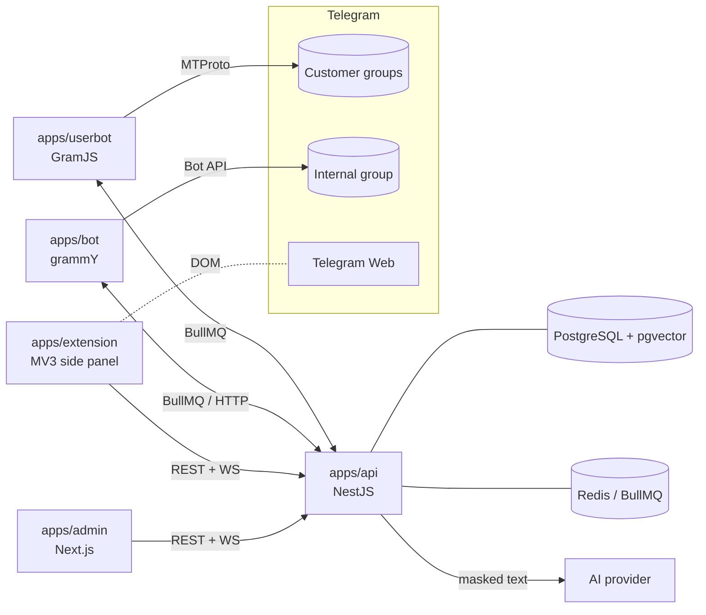

# PLAN — TP Ticket System

Internal ticket system for a 2–3 person technical-support team that answers customers (AmoCRM, Bitrix24, online PBX) in
Telegram group chats through one shared TP account. All code/docs in English, all user-visible strings in Uzbek (Latin) behind
an i18n dictionary (`uz` default, `ru` can be added).

This file is the single source of truth for decisions. `STATUS.md` records what is actually done and verified.

## 1. Decisions made without asking

| Topic | Decision |
| --- | --- |
| Repo location | New monorepo `ticket-system/` next to the prototype. The prototype (`../extension`) stays untouched; its code is **copied** into `apps/extension` in phase P7 and evolved there. |
| Package manager / runtime | pnpm workspaces, Node 22+ (24 locally). |
| Shared package build | `tsup` → CJS + ESM + d.ts, consumed by Nest (CJS), Next/Vite (ESM). |
| API framework | NestJS 11, Prisma 6, PostgreSQL 17 + pgvector, Redis + BullMQ, Socket.IO gateway, Swagger. |
| Auth | argon2id; access JWT 15 min; refresh token = random 256-bit, stored as SHA-256 hash, **rotated on every use**, reuse of a rotated token revokes the whole family; lockout after 5 failures / 15 min (per username + IP) via DB counters. |
| Secrets at rest | AES-256-GCM, key from `ENCRYPTION_KEY` (32 bytes base64). Envelope: `v1.<iv>.<tag>.<ciphertext>` base64url. |
| Userbot ↔ API | Only via BullMQ queues + Redis pub/sub events. The userbot has **no database access**; it calls the API with a service token for lookups that need state. |
| Bot ↔ API | Same: bot is a thin Telegram adapter; domain logic (assignment, cards) lives in the API (`TelegramFacade` interface) so it is testable with fakes. |
| Telegram access | Everything real (MTProto, Bot API, Telegram Web DOM) is behind interfaces (`TelegramUserClient`, `BotGateway`) with in-memory fakes for tests and demo mode. |
| Id normalisation | Telegram Web uses `-1001234567890` or `-1234567890` for supergroups/groups; MTProto uses positive channel/chat ids. `packages/shared` has `normalizePeerId()` producing a canonical string `c:<id>` / `g:<id>` / `u:<id>`. |
| One open ticket per group | Enforced by a **partial unique index** (`WHERE status <> 'CLOSED'`) — the DB is the arbiter in races, not application code. |
| Atomic assignment | `UPDATE … WHERE id = $1 AND assignee_id IS NULL` inside a transaction; the row count decides the winner. Idempotent (same user pressing twice → no-op success). |
| Overdue stage | Virtual: computed from `slaDeadline` and status, never stored. |
| AI | `AiService` with provider adapters (Anthropic via `@anthropic-ai/sdk`, OpenAI-compatible via `fetch`); zod-validated structured outputs; fail-open classification. |
| Embeddings | Configurable model; pgvector column on `KbChunk`. If no embedding model is configured → Postgres full-text search (`simple` dictionary + trigram-free ILIKE fallback). |
| Demo mode | `DEMO_MODE=true` seeds fake groups/tickets/users and swaps real Telegram adapters for fakes. |
| Extension location of AI | Extension has no AI settings at all; it calls `POST /ai/draft`. |

## 2. Architecture

Services: `api`, `userbot`, `bot`, `admin`, `postgres`, `redis` (docker compose). Workers inside `api` (BullMQ processors):
intake (debounce + classify), reminders/SLA, folder reconcile (computes the plan; the userbot applies it), KB generation, digests.

## 3. Data model (Prisma, summary)

`User`, `RefreshToken`(family), `LoginAttempt`, `AuditLog`, `ClientGroup`, `Ticket`(number sequence, partial-unique open index),
`TicketMessage`, `TicketEvent`, `Funnel`/`FunnelStage`, `SlaPolicy`, `Template`, `KbArticle`, `KbChunk`(vector), `AiProvider`,
`AiSettings`, `AiUsageLog`, `FilteredMessage`, `TelegramFolderState`, `UserbotSession`, `Setting`, `Reminder`, `StaffActivity`.
The authoritative schema is `apps/api/prisma/schema.prisma`.

## 4. API outline

| Area | Endpoints (prefix `/api/v1`) |
| --- | --- |
| Auth | `POST /auth/login`, `/auth/refresh`, `/auth/logout`, `/auth/change-password`, `GET /auth/me` |
| Users (admin) | `GET/POST /users`, `PATCH /users/:id`, `POST /users/:id/reset-password`, `/users/:id/telegram-code` |
| Client groups | CRUD + `POST /client-groups/import` (from userbot discovery) |
| Tickets | list/filter, `GET /tickets/:id`, `POST /tickets/:id/{assign,take,status,close,note,merge}`, `GET /tickets/by-chat/:peerId` |
| Funnel | `GET /funnel/board`, `POST /funnel/move`, stages CRUD, SLA policies CRUD |
| Templates / KB | CRUD, `POST /templates/:id/use`, KB approve/reject, search |
| AI | `POST /ai/draft`, `GET/PUT /ai/settings`, `POST /ai/test`, `GET /ai/usage` |
| Intake | `GET /filtered-messages`, `POST /filtered-messages/:id/create-ticket` |
| Telegram | userbot login flow, status, folders (`state`, `dry-run`, `sync`), internal group config |
| Stats | `GET /stats/*`, CSV export |
| Realtime | Socket.IO namespace `/events` (JWT handshake): `ticket.created/updated`, `reminder`, `sla.warning` |
| Ops | `GET /health`, `GET /health/ready`, Swagger at `/docs` |

## 5. Phases and acceptance criteria

| Phase | Scope | Acceptance (automatically verified unless noted) |
| --- | --- | --- |
| P0 | monorepo, `packages/shared` (masking, id normalisation, i18n, zod schemas, SLA math), env schema, docker compose, Dockerfiles, CI | `pnpm test` green for shared; compose file validates (`docker compose config`) |
| P1 | Prisma schema + migration, API auth/users/audit, lockout, seed admin, e2e tests; admin shell + login; extension login | e2e: login, refresh rotation, reuse detection, lockout, role guard, forced password change |
| P2 | client groups, tickets, events, SLA, templates, realtime gateway | e2e: ticket lifecycle, one-open-ticket constraint, **atomic assignment race** |
| P3 | userbot (interfaces + GramJS adapter), intake pipeline (rules + AI + debounce), commands, outgoing detection | unit: rules, command parser; fake-client pipeline test. Real Telegram: MANUAL |
| P4 | internal bot: linking, cards, buttons, strategies, reminders, digests | unit: strategies; fake-gateway flow test. Real bot: MANUAL |
| P5 | funnel, Kanban, folder reconcile + limits + dry run | unit: desired-state diff with fake Telegram; limits degradation |
| P6 | AI settings/usage, KB, embeddings/RAG, drafts, KB growth | unit: provider adapters with fake HTTP, grounding/not_found; e2e draft |
| P7 | extension on real data (login, WS, features), send-activity ping, badges | build + unit (id normalisation); DOM parts MANUAL |
| P8 | stats, extras, hardening, docs, demo seed | docs complete; `docker compose up` with demo seed — MANUAL |

## 6. Risks (see also the end of STATUS.md)

Userbot on a shared account violates Telegram's expectations for automation (ban risk); folder limits; Telegram Web DOM drift;
AI cost; one account shared by several humans makes attribution heuristic only.
