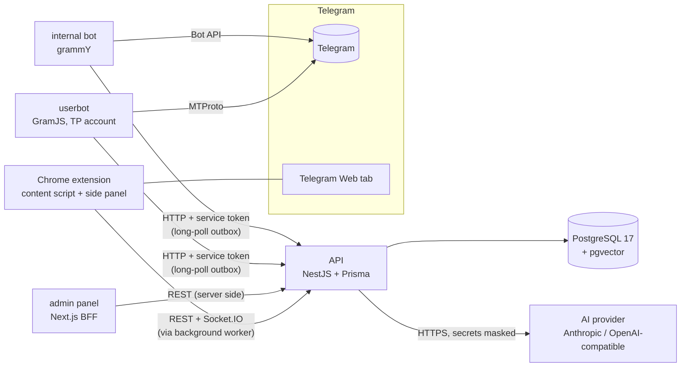

# Architecture

How the system fits together and why. What is verified and what is not: [STATUS.md](../STATUS.md). Decisions and
deviations from the original spec: [PLAN.md](../PLAN.md) and the "Deviations" list in STATUS.md.

## 1. Components



| Component   | Responsibility                                                                                                                                | Never does                                                          |
| ----------- | --------------------------------------------------------------------------------------------------------------------------------------------- | ------------------------------------------------------------------- |
| API         | All domain logic and state: tickets, SLA, assignment, funnel, folders plan, KB search, AI calls, auth, audit, realtime                        | Talk to Telegram directly                                           |
| userbot     | Reads customer groups, reports messages/reactions, executes commands from the outbox (delete own command messages, discovery, folders, login) | Send anything to a customer chat; read the database                 |
| bot         | Posts and edits ticket cards in the internal group, handles buttons and `/` commands, sends reminders                                         | Contain domain rules (it calls the API)                             |
| admin panel | Management UI. A BFF: the browser only talks to the panel; session tokens live in httpOnly cookies                                            | Expose `internal/*` API routes or tokens to the browser             |
| extension   | Shows the ticket of the open chat, inserts drafts into the composer, tells the server who presses Send                                        | Press Send, hold AI keys, or call the API from page-accessible code |

## 2. Hard rules and where they are enforced

| Rule                                             | Enforcement                                                                                                                                                |
| ------------------------------------------------ | ---------------------------------------------------------------------------------------------------------------------------------------------------------- |
| Nothing is sent to a customer chat automatically | userbot has no "send message" command at all; only `DELETE_MESSAGES` (and the adapter checks `out`); extension only fills the composer and listens to Send |
| AI provider and keys exist only on the server    | keys are encrypted (AES-256-GCM) in `AiProvider`, returned only as a last-4 hint; extension has no AI settings in server mode                              |
| Secrets are masked before any AI call            | `mask.ts` (shared) is applied in classification, drafts and KB growth; drafts return the masked preview                                                    |
| One open ticket per group, one assignee          | partial unique index; assignment is `UPDATE ... WHERE assigneeId IS NULL` (row count decides the winner)                                                   |
| No self-registration                             | users are created by admins only; first admin seeded from env and forced to change the password                                                            |
| Telegram/AI failures must not stop the workflow  | classification fails open (ticket is created, `needsReview`), drafts fall back to extractive, outbox items retry, folder sync degrades with warnings       |

## 3. Main flows

**Intake (customer message -> ticket).** userbot `POST /internal/userbot/messages` -> prefilter rules (empty, emoji, too short,
acknowledgement, staff message) -> attach to the open ticket if there is one -> otherwise a DB-backed debounce buffer
(25 s by default) merges a burst of messages -> AI classification on the masked text (is it a request, system, urgency,
summary) -> ticket created in the group's SLA policy -> events: realtime (Socket.IO), bot card (outbox), folder reconcile
(debounced). Filtered messages are stored and can be turned into tickets by a human.

**Assignment.** Card button / panel "Men olaman" / `.take` -> atomic claim; the loser gets "already taken". Strategies
(manual, fixed owner, round robin, least loaded, on duty) pick an assignee automatically where configured. The first
outgoing staff message stamps `firstResponseAt` and moves the deadline to the resolution SLA. Who sent it is attributed from
the extension's activity ping (all staff share one Telegram account), with a confidence value.

**AI draft.** `.ai` in a customer chat (userbot deletes the command, API emits `ai.requested`) or the extension's "AI javob"
-> context from the stored conversation -> mask -> retrieve (vector + full-text, fused with RRF, relevance guard) ->
grounded prompt, or `notFound` without calling the model -> draft stored -> delivered over Socket.IO to the person ->
inserted into the composer by a human. A later outgoing message is compared with the draft (unchanged / edited) to measure
quality. Closing a ticket with a solution note can seed a KB draft that an admin approves.

**Funnel and folders.** Kanban columns are derived from tickets (new, one per staff member, waiting, virtual overdue,
closed). A pure planner diffs the desired Telegram folders with the real ones (`LIST_FOLDERS` over the outbox), applies
only folders it created (`APPLY_FOLDERS`), respects quotas, and logs every operation.

**Extension session.** Login in Options -> background worker stores the token pair -> every API call goes through the
worker (`TP_API`), which refreshes tokens once for concurrent calls -> the worker also holds the Socket.IO connection and
forwards events to the panels.

## 4. Data and consistency

- PostgreSQL is the only store of truth. Redis is in the compose file for future fan-out but the current code does not use it:
  debounce buffers and the userbot/bot outboxes are tables (`FOR UPDATE SKIP LOCKED`, stale claims are swept/re-handed).
- Domain events are in-process (`DomainEvents`); realtime, bot cards and folder sync subscribe to them. This is why the
  API is a single instance today (see risks).
- Anything that must be unique or atomic is enforced by the database (partial unique index, conditional updates, advisory
  lock for folder sync), not by application checks.
- Secrets at rest: AES-256-GCM envelope with `ENCRYPTION_KEY`; refresh tokens are stored as SHA-256 hashes and rotated with
  reuse detection; the audit log records who changed what (settings changes include old/new values; there are no secrets
  among them).

## 5. Trust boundaries

1. **Browser <-> admin panel:** cookies (httpOnly, SameSite=Strict, `Secure` behind HTTPS), CSRF header on mutations.
2. **Panel/extension <-> API:** short-lived JWT + rotating refresh tokens; role checks in the API (the UI only hides things).
3. **userbot/bot <-> API:** a shared service token on `internal/*`; those routes are refused by the panel proxy and by the
   extension's background worker.
4. **API <-> AI provider:** only masked text and retrieved KB material leave the server; a monthly budget with hard stop.
5. **Extension content script <-> Telegram page:** one shadow root, selectors isolated in `selectors.ts`, no synthetic
   key/click events, nothing is sent.

## 6. Failure behaviour

| Failure                         | Result                                                                                                                      |
| ------------------------------- | --------------------------------------------------------------------------------------------------------------------------- |
| AI provider down / budget spent | tickets are still created (`needsReview`); drafts fall back to extractive answers from the KB                               |
| userbot offline                 | messages are not read (nothing is lost on the server); commands wait in the outbox; stale claims are failed or re-queued    |
| bot offline                     | cards queue up and are delivered when it returns; stale claims are handed out again                                         |
| Telegram folder limits          | per-staff folders are dropped first, warnings shown in the panel; foreign folders are never touched                         |
| API restart                     | outboxes and buffers are tables, nothing in memory is required; the extension reconnects its socket and refreshes its token |
| refresh token reuse             | the whole token family is revoked; panel and extension fall back to the login screen                                        |

## 7. Known limits (see STATUS.md for the full list)

- Single API instance (in-process events; the panel's refresh cache is per process).
- Nothing has run against a real Telegram account, a real AI provider, or in a real Chrome with Telegram Web.
- GramJS and grammY adapters are written from documentation and unverified; everything above them is tested with fakes.
- The API image is large (the whole workspace); slimming it is tracked in docs/PROGRESS.md.

## 8. Code layout of `apps/api/src`

```text
main.ts, setup.ts, app.module.ts     bootstrap and module wiring
apps/                                feature modules (business logic)
  auth/      login, refresh, guards and the Public/Roles/CurrentUser decorators
  users/     staff accounts, Telegram link codes, first-admin seed
  tickets/   tickets, client groups, templates (the support-desk core)
  intake/    userbot messages -> tickets, debounce, outbox, attribution, auto-assign
  bot/       internal bot: cards, callbacks, commands, reminders, digest
  funnel/    Kanban stages and board, Telegram folder reconcile
  kb/        knowledge base, search, AI drafts, KB growth
  ai/        provider adapters, usage and budget, AI settings endpoints
  admin/     audit log API, SLA policies, statistics + CSV
  demo/      DEMO_MODE seed
common/                              cross-cutting code
  env.ts, config.module.ts           validated environment
  prisma.service.ts, crypto.service.ts (AES-256-GCM), http.ts (AppError, ZodPipe)
  audit.service.ts, domain-events.ts (in-process event bus), settings.service.ts
  realtime.gateway.ts (Socket.IO), health.controller.ts
  domain/                            pure, framework-free rules (assignment, intake rules, folder planner) + their tests
```

Rules: features import `common`, never the other way round, with one deliberate exception: three `common` files
(`health.controller`, `settings.service`, `realtime.gateway`) use `apps/auth` (guards/decorators, token verification).
Features talk to each other through their Nest modules, not by reaching into another feature's internals. Unit tests sit next
to the code (`*.spec.ts`); e2e tests are in `test/`.
